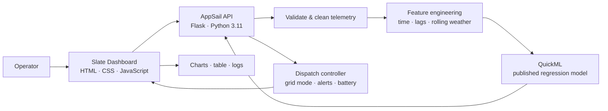
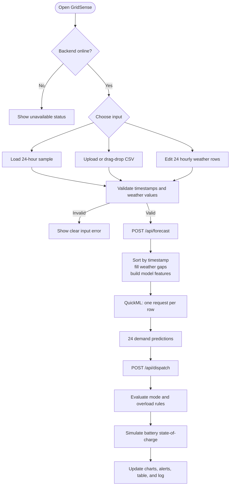

# GridSense

### Smart Energy Microgrid & Demand Forecasting Engine

> **HackSphere 3.0** · Zoho Catalyst · QuickML · AppSail · Slate

GridSense is a decision-support dashboard for the next 24 hours of electricity
demand. It turns weather telemetry into demand forecasts, then converts each
forecast into an explainable grid decision:

- **Main Grid Mode** for normal demand
- **Renewable Storage Mode** for high-demand and evening-peak periods
- **Critical Overload Alert** for demand at or above 200 kW

The project combines a published Zoho Catalyst QuickML regression model with a
pure-Python Flask API and a polished Slate dashboard.

## Live project

| Resource | Link |
| --- | --- |
| **Live dashboard** | [dashboard-oetrdqbn.onslate.in](https://dashboard-oetrdqbn.onslate.in) |
| **AppSail API** | [forecast-api-50047160503.development.catalystappsail.in](https://forecast-api-50047160503.development.catalystappsail.in) |
| **GitHub repository** | [preemalsimona05/gridsense-hacksphere-3.0](https://github.com/preemalsimona05/gridsense-hacksphere-3.0) |

Open the Slate dashboard for the full user experience. The AppSail URL is the
backend service used by the dashboard.

## Why GridSense?

Renewable energy makes local power systems more flexible, but operators still
need to anticipate sudden demand changes. GridSense answers three practical
questions:

1. **How much demand should we expect each hour?**
2. **Should the system use the main grid or local storage?**
3. **Is the predicted demand high enough to require an overload warning?**

Instead of showing a prediction alone, GridSense turns the prediction into an
operating plan with a demand curve, dispatch badges, battery state-of-charge,
and visible alerts.

## Stack flowchart



### Technology responsibilities

| Layer | Technology | What it does |
| --- | --- | --- |
| **Frontend** | Catalyst Slate, plain HTML/CSS/JavaScript | Collects telemetry and presents the operating plan |
| **Charts** | Chart.js from cdnjs | Renders demand and battery state-of-charge |
| **Backend** | Catalyst AppSail, Flask, Python 3.11 | Validates input, engineers features, orchestrates inference |
| **Model** | Catalyst QuickML | Predicts `target_demand_kw` for each hour |
| **Controller** | Pure Python | Applies storage, overload, and battery rules |
| **Deployment** | Catalyst CLI + PowerShell | Injects runtime configuration without committing secrets |

The AppSail runtime intentionally uses only Python's standard library, Flask,
and requests. It does not depend on pandas or NumPy.

## Web flowchart



## Data and model contract

### User input

Every forecast row contains:

```text
timestamp, ambient_temp_c, humidity_pct, solar_irradiance_wm2
```

The training target is `target_demand_kw`. It is used only during model
training and is intentionally absent from live inference inputs.

### Engineered features

The shared feature pipeline adds:

- `hour`, `day_of_week`, `month`
- `is_weekend`, `is_evening_peak`
- `hour_sin`, `hour_cos`
- temperature lag of 1 hour and 3 hours
- rolling 3-hour temperature mean
- humidity lag of 1 hour
- solar irradiance lag of 1 hour

Rows are sorted chronologically **before** lag and rolling features are
calculated. Missing weather values are interpolated and then filled with a
median fallback. Target-demand lags are never used because future target values
are unavailable during inference.

### QuickML request

GridSense sends one model row per request:

```json
{
  "data": {
    "ambient_temp_c": 20.0,
    "humidity_pct": 60.0,
    "solar_irradiance_wm2": 0.0,
    "hour": 0,
    "day_of_week": 2,
    "month": 1,
    "is_weekend": 0,
    "is_evening_peak": 0,
    "hour_sin": 0.0,
    "hour_cos": 1.0,
    "ambient_temp_c_lag_1h": 20.0,
    "ambient_temp_c_lag_3h": 20.0,
    "ambient_temp_c_rolling_3h_mean": 20.0,
    "humidity_pct_lag_1h": 60.0,
    "solar_irradiance_wm2_lag_1h": 0.0
  }
}
```

The timestamp is used for feature engineering but is not sent as a model
feature. QuickML returns a numeric value in `result[0]`.

## Dispatch rules

These rules are intentionally deterministic and are applied independently to
each predicted hour:

| Condition | Result |
| --- | --- |
| Demand `> 160 kW` **or** hour `18:00–22:00` inclusive | Renewable Storage Mode |
| Otherwise | Main Grid Mode |
| Demand `>= 200 kW` | Critical Overload Alert, independent of mode |

The battery demonstration uses these transparent assumptions:

- Capacity: **500 kWh**
- Starting charge: **250 kWh**
- Main Grid Mode charge rate: **25 kW per hour**
- Renewable Storage Mode discharge rate: **50 kW per hour**

## Dashboard features

- Live AppSail health indicator
- Sample 24-hour input loader
- CSV upload with drag and drop
- Editable 24-row weather form
- Demand chart with 160 kW and 200 kW thresholds
- Shaded 18:00–22:00 evening storage window
- Critical overload banner listing every affected hour
- Peak demand, storage-hour, overload-hour, and battery summary cards
- Battery state-of-charge chart
- Hourly dispatch table with mode and system state badges
- Activity log for recent forecast runs
- Responsive layout with light and dark themes
\n+## Screenshots\n+\n+<p align=\"center\">\n+  \n+</p>\n+\n+<p align=\"center\">\n+  \n+</p>\n+\n+<p align=\"center\">\n+  \n+</p>\n+\n+<p align=\"center\">\n+  \n+</p>\n+\n+<p align=\"center\">\n+  \n+</p>\n \n ## Repository map\n*** End Patch"} 
                                                                                                                                                                                                    
## Repository map

```text
.
├── app/
│   ├── appsail-python/       Flask API, controller, feature parity tests
│   ├── dashboard/            Slate frontend
│   └── catalyst.json         Catalyst AppSail + Slate mapping
├── analysis/
│   └── explore.py            EDA, plots, time-based validation, export
├── features.py               Shared pandas feature engineering
├── predict.py                QuickML batch inference CLI
├── debug_endpoint.py         Safe one-request endpoint diagnostic
├── scripts/deploy.ps1        Secure AppSail deployment helper
├── train_telemetry.csv       4,000 labeled training rows
├── sample_test_input.csv     1,000 unlabeled inference rows
├── train_features.csv        QuickML-ready engineered training data
├── test_eval.py              Hackathon pre-submission self-test
└── .env.example              Safe configuration template
```

## Commands: what they are for

The commands in this README are **developer and deployment tools**, not
features that the end user needs to run. The public user only opens the Slate
dashboard.

### 1. Run the required hackathon self-test

```powershell
python test_eval.py
```

Checks that `predict.py` imports, returns one finite prediction per input row,
and satisfies the starter-kit contract. Expected result: `SUCCESS`.

### 2. Run batch prediction locally

```powershell
python predict.py --input sample_test_input.csv --output predictions.csv
```

Uses the published QuickML endpoint to create a CSV with exactly:

```text
timestamp,target_demand_kw
```

### 3. Run backend tests

```powershell
python -m pytest app\appsail-python\tests
```

Checks controller boundary conditions and parity between the pandas feature
pipeline and the pure-Python AppSail implementation.

### 4. Preview the dashboard locally

```powershell
python -m http.server 18765 --directory app\dashboard
```

This serves the static frontend at `http://127.0.0.1:18765`. It is only for
local testing; it is not the public submission URL. The frontend API target is
the `API_BASE` constant at the top of `app/dashboard/main.js`.

### 5. Deploy to Catalyst

```powershell
powershell -ExecutionPolicy Bypass -File scripts\deploy.ps1
```

The script reads `.env` on the local machine, temporarily injects deployment
configuration, runs `catalyst deploy`, and always restores `app-config.json`.
It prints variable names only—never values.

To validate the mapping without deploying:

```powershell
powershell -ExecutionPolicy Bypass -File scripts\deploy.ps1 -SkipDeploy
```

## Secure configuration

Copy `.env.example` to `.env` and fill in the real local values. The `.env`
file is ignored by Git and must never be committed.

The local names are mapped to neutral AppSail names because Catalyst rejects
some reserved environment-variable prefixes:

| Local `.env` name | Deployed AppSail name |
| --- | --- |
| `QUICKML_ENDPOINT_URL` | `HS_QML_URL` |
| `QUICKML_ENDPOINT_KEY` | `HS_QML_KEY` |
| `CATALYST_ORG` | `HS_ORG_ID` |
| `CATALYST_ENVIRONMENT` | `HS_ENV_NAME` |
| `ZOHO_CLIENT_ID` | `HS_OAUTH_ID` |
| `ZOHO_CLIENT_SECRET` | `HS_OAUTH_SECRET` |
| `ZOHO_REFRESH_TOKEN` | `HS_OAUTH_REFRESH` |
| `ZOHO_ACCOUNTS_URL` | `HS_OAUTH_URL` |

The backend prefers `HS_` names in AppSail and falls back to original names
locally. OAuth access tokens are refreshed in memory and are never sent to the
frontend or logged.

## Validation status

- ✅ QuickML endpoint tested with real inference
- ✅ 4,000 training rows analyzed
- ✅ Time-based 80/20 validation completed
- ✅ Backend controller and feature parity tests pass
- ✅ `test_eval.py` prints `SUCCESS`
- ✅ AppSail deployed and tested end to end
- ✅ Slate dashboard deployed and browser-tested
- ✅ `.env` and generated secrets excluded from Git

## Submission

- **Public app:** [dashboard-oetrdqbn.onslate.in](https://dashboard-oetrdqbn.onslate.in)
- **Source repository:** [github.com/preemalsimona05/gridsense-hacksphere-3.0](https://github.com/preemalsimona05/gridsense-hacksphere-3.0)

The hackathon submission form additionally requires a presentation exported as
PDF. The README and repository are for the source-code deliverable; the PDF is
the separate project explanation deliverable.
